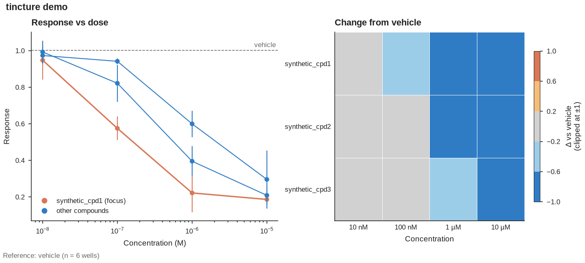

# tincture

Question-first, publication-quality plots for drug-discovery data, built on proper statistics.

Drug-discovery papers recycle the same generic plots (PCA, UMAP, volcano, GSEA bars). Those show the *structure* of the data, not answers to drug-discovery questions. tincture organises plotting around the questions:

| Question | Plot | Status |
|---|---|---|
| What does this compound look like? | Compass, Neighbourhood Card | planned (M3, M5) |
| Does the mechanism change with dose? | Dose Paths | planned (M3) |
| What did it do biologically? | Fingerprint Strip, Effect Ladder | planned (M3) |
| Is the effect real? | Retrievability, Plate Atlas | planned (M2) |
| Is there a safe, effective dose? | Window | planned (M5) |
| How specific is it? | Selectivity Spectrum | planned (M5) |
| Does potency hold up from enzyme to cell to phenotype? | Engagement Ladder | planned (M6) |
| Do two drugs work better together, at reachable doses? | Combination Surface / Lift | planned (M7) |
| What happens first, and what follows? | Onset Timeline | planned (M7) |

Every plot ships with:
- the figure;
- a **reading-guide caption** templated from the computed statistics (no LLM);
- a **methods paragraph** with citations and software versions;
- where a conventional plot exists, a **classic fallback** (e.g. PCA, volcano) for reviewers.

Uncertainty is on by default. When a result is weak (a failed fit, no confident neighbour, a bend within noise), the figure says so.

> **Status: Milestone 0 of 7.** The rendering core (PlotSpec, renderer, theme, journal export, captions) is in place. The question-first plots arrive milestone by milestone: see [`HANDOVER.md`](HANDOVER.md) §8 and the reports in [`docs/`](docs/).

## Install

```bash
pip install -e ".[dev]"
```

Optional extras: `[omics]` (pydeseq2, decoupler, scanpy; about 600 MB installed), `[chem]` (rdkit, mmpdb). Requires Python ≥ 3.10.

## Quick look

```python
import tincture as tc

# Long table: compound_id, dose (molar, 0 = vehicle), replicate, value
res = tc.demo(df, focus="cpd1")  # every plot returns a PlotResult
print(res.caption)  # templated reading guide
print(res.methods)  # methods paragraph + software versions

# Writes fig1.pdf, fig1.png, fig1.md (caption, methods, warnings) and fig1_classic.*
tc.export(res, "figures/fig1", preset="nature_double")
```



*The demo plot on **synthetic** test data. It exercises the pipeline only and is not a tincture analysis plot.*

## Design in one paragraph

Plot builders compute statistics and return a `PlotSpec`, a plain dataclass of panels, marks, scales, caption, methods and footer. `render_mpl(spec, preset=...)` is the only code that touches matplotlib, which keeps an interactive backend possible later. Colours are semantic: terracotta always means the compound the figure is about, blue is reference or known-MoA, purple is novel or unexplained, and green is good or window. Sequential colours are perceptually uniform maps only; jet and rainbow raise an error.

## Export rules

`tc.export` / `PlotResult.save`:
- renders at the exact journal width (`nature_single` 89 mm, `nature_double` 183 mm, `cell_*`, `acs_*`; see [`docs/design/journal_presets.md`](docs/design/journal_presets.md));
- embeds TrueType fonts;
- **refuses** to export a figure with text under 6 pt, or with categorical colours that become indistinguishable under simulated deuteranopia or protanopia (CIEDE2000 < 10).

Output does not depend on your matplotlib style.

## Data

Case studies run on real public datasets (sci-Plex, PRISM, GDSC, LINCS, NanoBRET, Davis and others). **No data is stored in this repository.** Loaders download into a git-ignored `data/` cache with checksums, because several sources (GDSC in particular) forbid redistribution. Provenance and verification notes are in [`docs/data_status.md`](docs/data_status.md).

## Development

```bash
pytest
```

This runs the unit, guard and visual-regression tests.

```bash
pytest -m realdata
```

This runs the case studies on downloaded data; they are skipped when data are absent.

```bash
pytest -k baseline --mpl-generate-path=tests/baseline
```

This regenerates image baselines; do it only intentionally.

```bash
ruff check . && ruff format --check . && mypy
```

Image baselines are tied to the matplotlib version in `tests/baseline/MATPLOTLIB_VERSION`. With any other version, pixel comparison is skipped.

## Licence

Apache-2.0. Dataset licences are separate and are noted per dataset in `docs/data_status.md`.
