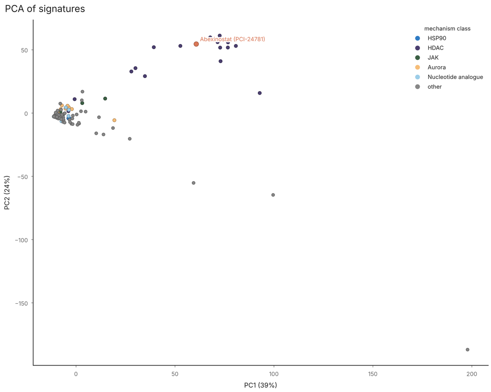
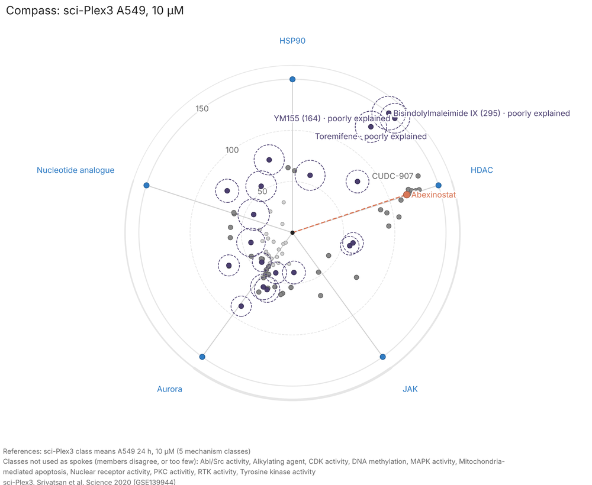
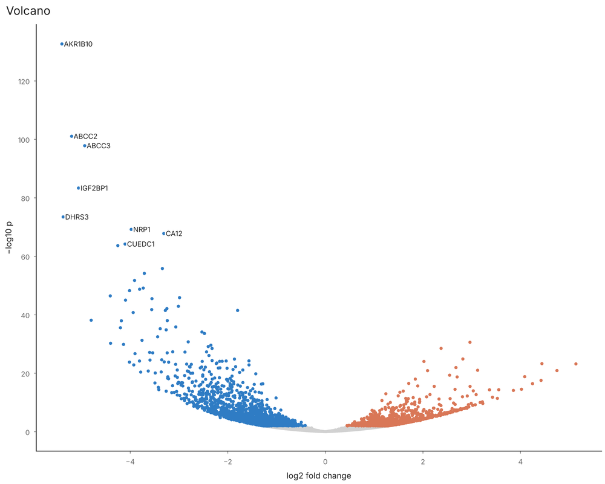

# tincture

Question-first, publication-quality plots for drug-discovery data, built on proper statistics.

Drug-discovery papers recycle the same generic plots (PCA, UMAP, volcano, GSEA bars). Those show the *structure* of the data, not answers to drug-discovery questions. tincture organises plotting around the questions:

| Question | Plot | Status |
|---|---|---|
| What does this compound look like? | Compass, Neighbourhood Card | **available** |
| Does the mechanism change with dose? | Dose Paths | **available** |
| What did it do biologically? | Fingerprint Strip, Effect Ladder | **available** |
| Is the effect real? | Retrievability, Plate Atlas | **available** |
| Is there a safe, effective dose? | Window | **available** |
| How specific is it? | Selectivity Spectrum | **available** |
| Does potency hold up from enzyme to cell to phenotype? | Engagement Ladder | **available** |
| Do two drugs work better together, at reachable doses? | Combination Surface / Lift | available |
| What happens first, and what follows? | Onset Timeline | available |

Every plot ships with:
- the figure;
- a **reading-guide caption** templated from the computed statistics (no LLM);
- a **methods paragraph** with citations and software versions;
- where a conventional plot exists, a **classic fallback** (e.g. PCA, volcano) for reviewers.

Uncertainty is on by default. When a result is weak (a failed fit, no confident neighbour, a bend within noise), the figure says so.

> **Status: Milestone 7 of 7.** Thirteen question-first plots, each run against a pre-specified check on real public data (sci-Plex, PRISM, GDSC monotherapy and combinations, LINCS L1000, Davis 2011, NanoBRET, MIX-seq): **Retrievability**, **Plate Atlas**, **Compass**, **Dose Paths**, **Fingerprint Strip**, **Effect Ladder**, **Window**, **Neighbourhood Card**, **Selectivity Spectrum**, **Engagement Ladder**, **Combination Surface**, **Combination Lift** and **Onset Timeline**. Underneath: verified loaders and a statistics layer (empirical-Bayes signatures, pathway scores, NNLS projection, dose-path bend test, 4PL fits with bootstrap, neighbour nulls, Bliss/ZIP/HSA synergy with honest uncertainty, interval-censored onsets). See the [gallery](docs/gallery.md), the [API reference](docs/api.md) and the milestone reports in [`docs/`](docs/).

## Before / after

The plot people usually draw (left; tincture also exports it as the *classic fallback*) next to the question-first version (right). Real data: sci-Plex3 A549, 24 h; abexinostat, an HDAC inhibitor, in terracotta. More in the **[gallery](docs/gallery.md)**.

| Question | Classic | tincture |
|---|---|---|
| What known mechanism does this compound resemble? |  |  |
| Does the mechanism change with dose? |  |  |
| Which genes moved, and how sure are we? |  |  |

## Install

```bash
pip install -e .
```

Extras: `[dev]` (tests, lint, types), `[omics]` (pydeseq2, decoupler, scanpy; about 600 MB, only needed for PROGENy gene sets and DESeq2 tables), `[chem]` (rdkit, mmpdb). Requires Python ≥ 3.10.

## Reproduce the HDAC case study (CS1) in one command

From a fresh checkout, after `pip install -e .`:

```bash
python case_studies/cs1_sciplex_hdac.py
```

This runs Retrievability → Compass → Dose Paths → Fingerprint Strip → Effect Ladder on sci-Plex3 A549 and writes figures, captions, methods and three ground-truth checks to `case_studies/out/cs1_sciplex_hdac/report.md`. **The first run downloads 3.2 GB from GEO** (GSE139944, checksum-verified) and builds a 190 MB per-well cache; later runs take about 3 minutes. Data go to `$TINCTURE_DATA` (default `data/raw/` in a checkout).

## Quick look

```python
import tincture as tc
from tincture.io.sciplex import load_sciplex3
from tincture.stats.signatures import replicate_profiles

ps = load_sciplex3(cell_lines=["A549"], build=True)  # per-well pseudobulk (cached)

# Is each compound's phenotype real? (the gate before every other plot)
res = tc.retrievability(replicate_profiles(ps), focus=["S1090|1e-06"])  # abexinostat 1 µM
print(res.caption)  # templated reading guide, says when a result is weak
tc.export(res, "figures/retrievability", preset="nature_double")
# writes .pdf/.png, a .md sidecar (caption, methods, warnings), and the classic replicate scatter
```

```python
from tincture.datasets.genesets import load_geneset
from tincture.model.reference import library_from_signatures
from tincture.stats.paths import stress_gene_set

sigs = ps.signatures()[0]  # shrunk log fold changes vs same-line vehicle
hallmark = load_geneset("hallmark").table
top = {s.compound_id: s for s in sigs.signatures if s.dose == 1e-5}  # 10 µM
obs = ps.obs.drop_duplicates("compound_id").set_index("compound_id")
classes = {k: list(v.index) for k, v in obs.groupby("pathway_level_2")}
lib = library_from_signatures(
    {c: s.effect for c, s in top.items()},
    sigs.features,
    classes,
    version="A549 24 h",
    source="sci-Plex3 class means",
)

tc.compass(top, lib, focus="S1090")  # which known mechanism?
tc.dose_paths(sigs, ["S1090", "S1030"], lib, stress_gene_set(hallmark), focus="S1090")
tc.fingerprint(sigs, hallmark, focus="S1090")  # pathway-level strip, many compounds
tc.effect_ladder(sigs, "S1090", 1e-5, gene_sets=hallmark)  # which genes, how sure
```

CS1 additionally gates every plot on Retrievability and builds the reference classes from retrievable compounds only.

```python
from tincture.io.gdsc import load_gdsc2_plates
from tincture.stats.zprime import Selector

# Can we trust these plates? Z′, edge effect and control drift (GDSC data stay local)
plates = load_gdsc2_plates(max_plates=300)
qc = tc.plate_atlas(
    plates,
    neg=Selector(tags=("NC-1",)),
    pos=Selector(well_types=("blank",)),
    edge=Selector(tags=("UN-USED", "NC-1", "NC-0")),
)
```

Every plot returns a `PlotResult` with `.caption`, `.methods`, `.warnings`, `.classic` and `.save()`. All public functions are listed in the [API reference](docs/api.md).

## Design in one paragraph

Plot builders compute statistics and return a `PlotSpec`, a plain dataclass of panels, marks, scales, caption, methods and footer. `render_mpl(spec, preset=...)` is the only code that touches matplotlib, which keeps an interactive backend possible later. Colours are semantic: terracotta always means the compound the figure is about, blue is reference or known-MoA, purple is novel or unexplained, and green is good or window. Sequential colours are perceptually uniform maps only; jet and rainbow raise an error.

## Export rules

`tc.export` / `PlotResult.save`:
- renders at the exact journal width (`nature_single` 89 mm, `nature_double` 183 mm, `cell_*`, `acs_*`; see [`docs/design/journal_presets.md`](docs/design/journal_presets.md));
- embeds TrueType fonts;
- **refuses** to export a figure with text under 6 pt, or with categorical colours that become indistinguishable under simulated deuteranopia or protanopia (CIEDE2000 < 10).

Output does not depend on your matplotlib style.

## Data

Case studies run on real public datasets. **No data is stored in this repository.** Loaders download into a git-ignored cache (`$TINCTURE_DATA`, or `data/raw/` in a checkout) and verify every file against a pinned checksum, because several sources (GDSC in particular) forbid redistribution.

| Dataset | Loader | Returns |
|---|---|---|
| sci-Plex3 (GSE139944) | `tincture.io.sciplex.load_sciplex3()` | `PerturbationSet` of per-well pseudobulk counts (run `build_pseudobulk()` once; about 5 min) |
| PRISM Repurposing 20Q2 secondary | `tincture.io.prism.load_prism_secondary(compounds=[...])` | `DoseResponseSet` (raw viability + published fits with quality flags) |
| GDSC2 raw, release 8.5 | `tincture.io.gdsc.load_gdsc2_plates(max_plates=...)` | `PlateTable` (1536-well) |

```python
from tincture.io.prism import load_prism_secondary

prism = load_prism_secondary(compounds=["dabrafenib"])
curve = prism.get("BRD-K09951645", "ACH-000824")  # a DoseResponse
curve.quality_flags()  # why a fit should not be trusted, if at all
```

What was verified about each source, and where it differs from the papers or READMEs, is in [`docs/data_status.md`](docs/data_status.md). Examples: PRISM's README swaps the asymptotes, and GDSC wells are double-annotated.

## Development

```bash
pytest
```

This runs the unit, guard and visual-regression tests.

```bash
pytest -m realdata
```

This runs the case studies on downloaded data; they are skipped when data are absent.

```bash
pytest -k baseline --mpl-generate-path=tests/baseline
```

This regenerates image baselines; do it only intentionally.

```bash
ruff check . && ruff format --check . && mypy
```

Image baselines are tied to the matplotlib version in `tests/baseline/MATPLOTLIB_VERSION`. With any other version, pixel comparison is skipped.

## Licence

Apache-2.0. Dataset licences are separate and are noted per dataset in `docs/data_status.md`.
