# Gallery

Each plot answers one drug-discovery question. The left column is the plot people usually draw (tincture exports it too, as the *classic fallback*); the right column is the question-first version. Real data: sci-Plex3 A549, 24 h (Srivatsan et al. 2020, GEO GSE139944); abexinostat, an HDAC inhibitor, is the focus compound (terracotta). Reproduce with `python case_studies/cs1_sciplex_hdac.py` then `python docs/make_gallery.py`.

## Retrievability: Is the effect real?

| Classic: replicate scatter | tincture: Retrievability |
|---|---|
| 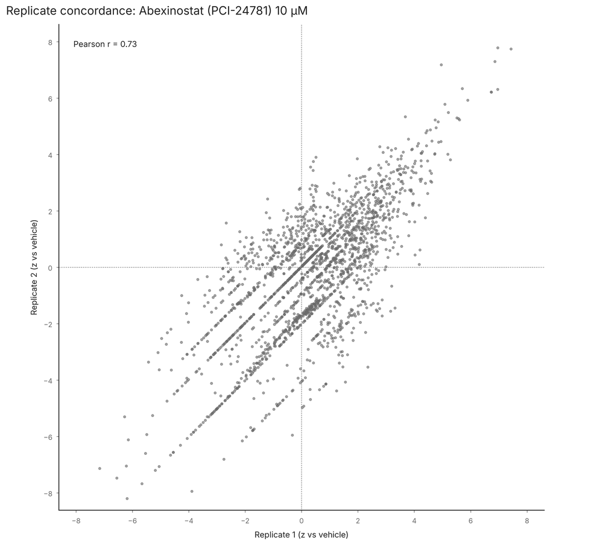 | 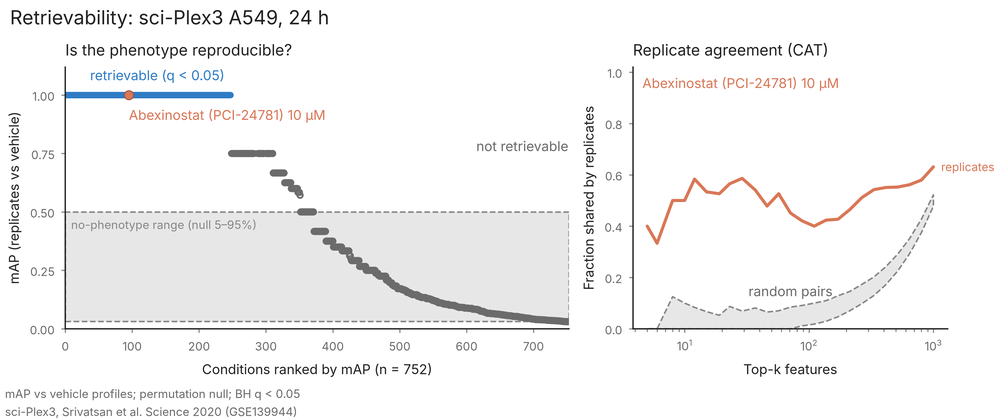 |

**Caption (generated).** 274 of 752 conditions (36%) have a reproducible phenotype (mAP, q < 0.05; replicates ranked against vehicle profiles); median mAP 0.42. Abexinostat (PCI-24781) 10 µM: mAP 1.00, q = 0.039 (retrievable). Replicate top-feature overlap for Abexinostat (PCI-24781) 10 µM exceeds the random band at 100% of k values. Note: the q-value boundary is not a single mAP value here (null depends on replicate counts); colours show per-condition calls.

**What changes:**
- every condition is tested against vehicle, with an FDR-controlled call per condition, instead of one correlation driven by a few large genes
- the null band shows what 'no phenotype' looks like; non-retrievable conditions are greyed and later plots can drop them (the gate)

## Compass: What known mechanism does this compound resemble, and how strongly?

| Classic: PCA (reference classes coloured) | tincture: Compass |
|---|---|
|  |  |

**Caption (generated).** Abexinostat most resembles HDAC (weight 0.98); 3% of its signature is unexplained by the 5 references. Its position is precise: the 95% region is smaller than the marker. 102 compounds; distance from centre = noise-corrected signature magnitude (log-fold changes vs vehicle). 19 with enough signal are poorly explained by the references (residual > 0.5, purple); 43 are too weak to judge (light grey). 2 compound(s) beyond the outer ring (150) are drawn on it, with their magnitude in brackets. Note: 86 compound(s) failed the retrievability gate and are not shown.

**What changes:**
- axes are mechanisms (reference classes), not principal components
- distance = noise-corrected signal strength; the residual says how much is unexplained, and compounds the references cannot explain are flagged
- the reference set and its version are printed; members are fitted leave-one-out

## Dose Paths: Does the mechanism change with dose?

| Classic: PCA coloured by dose | tincture: Dose Paths |
|---|---|
|  |  |

**Caption (generated).** Abexinostat moves from vehicle towards HDAC across 10 nM–10 µM without a significant bend (smallest corrected p = 0.84). 1 of 3 other compounds bend significantly: Panobinostat.

**What changes:**
- each compound is a path from vehicle through its doses, on axes with meaning (likeness to the reference; stress)
- bends are tested (turn > 30° beyond noise) and only significant ones are annotated; the reference class's own path is drawn for comparison

## Fingerprint Strip: What did each compound do, at pathway level?

| Classic: volcano (one compound) | tincture: Fingerprint Strip |
|---|---|
|  | 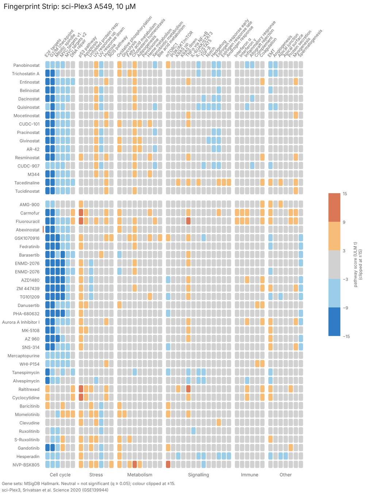 |

**Caption (generated).** 48 compounds × 48 pathways. Abexinostat is most similar to M344 (r = 0.99); strongest effect: E2F targets (down). Rows: references first in the given order, then average-linkage clustering of score correlations (optimal leaf order). 2 pathway(s) with no significant cell are not shown.

**What changes:**
- many compounds × curated pathway groups at once, references first
- non-significant cells are neutral (BH over the whole matrix); colour limits and row ordering are stated

## Effect Ladder: Which genes moved, and how sure are we?

| Classic: volcano | tincture: Effect Ladder |
|---|---|
|  |  |

**Caption (generated).** Top 30 features of Abexinostat at 10 µM by |shrunk log2 fold change|; 30 have 95% intervals excluding zero. Across all 13,086 features, 1,192 go up and 1,591 go down (q < 0.05).

**What changes:**
- the top genes with 95% intervals, grouped by gene set; intervals crossing zero are grey
- the count strip keeps the volcano's overview: how many genes went up and down across the transcriptome

## Engagement Ladder: Does potency hold up from enzyme to cell to phenotype, and where does it break?

Biochemical Kd (Davis et al. 2011), live-cell engagement in HEK293 (Vasta et al. 2018; apparent IC50 from single-dose occupancy) and PRISM viability (CS6). The dasatinib flag is discussed in the CS6 report: BCR-ABL in K562 vs full-length ABL1 in HEK293 is the likely reason.

| Classic: grouped bar chart of potencies | tincture: Engagement Ladder |
|---|---|
| 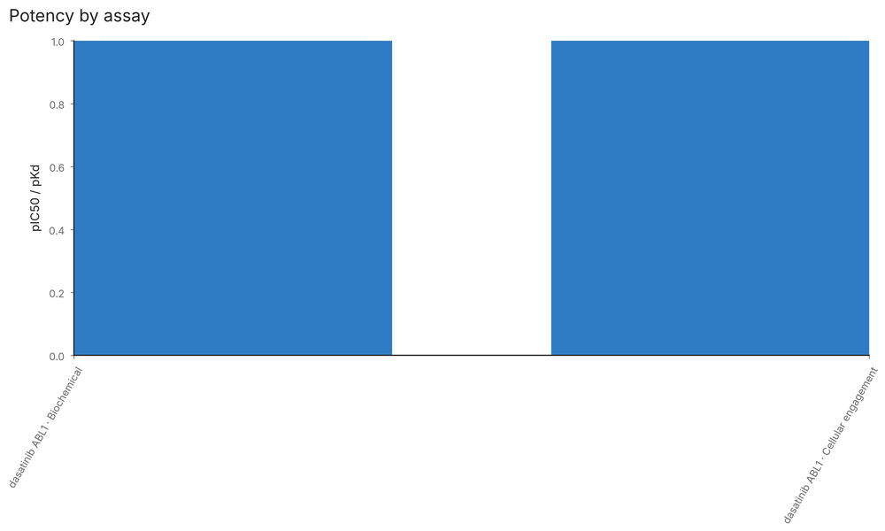 | 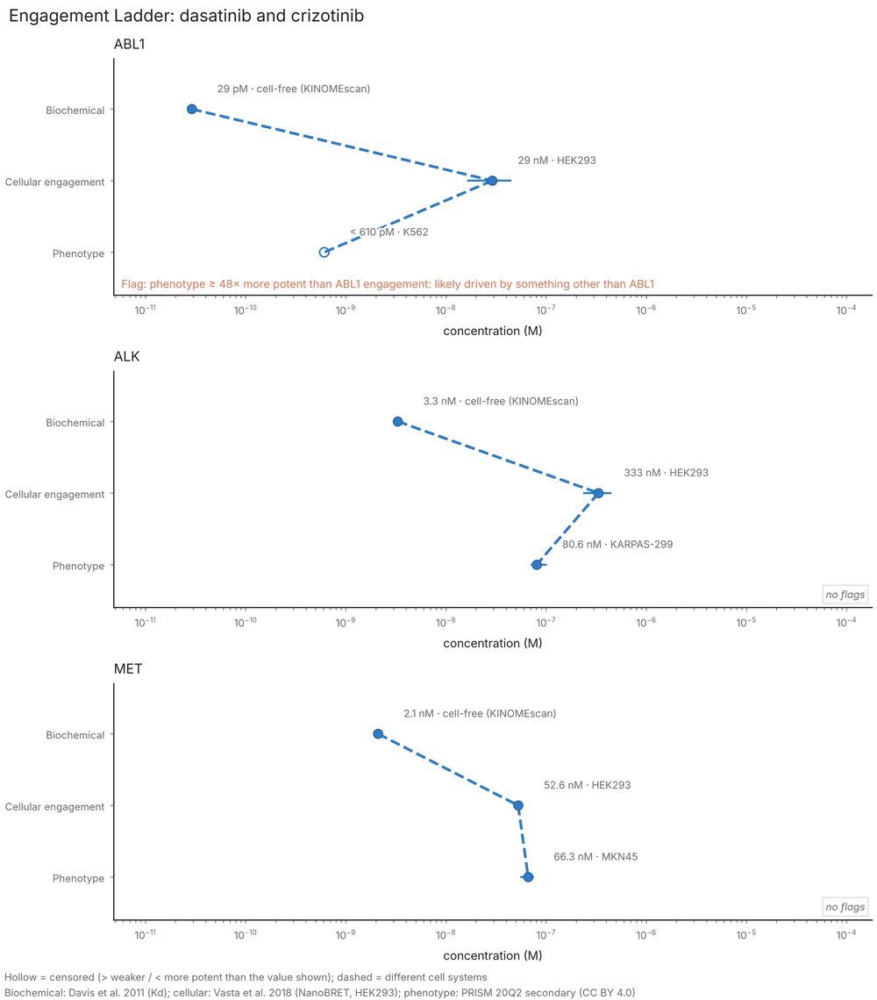 |

**Caption (generated).** dasatinib on ABL1: 3.0 log shift biochemical→cellular (ATP expectation not computed: no ATP Km); phenotype is 48× more potent than cellular target engagement. Flag: phenotype ≥ 48× more potent than ABL1 engagement: likely driven by something other than ABL1. crizotinib on ALK: 2.0 log shift biochemical→cellular (ATP expectation not computed: no ATP Km); phenotype is 4× more potent than cellular target engagement. crizotinib on MET: 1.4 log shift biochemical→cellular (ATP expectation not computed: no ATP Km); phenotype is in line with cellular target engagement. Dashed segments join rungs measured in different cell systems. Note: dasatinib/ABL1: ATP-shift flag not evaluated (no ATP Km supplied for ABL1). Note: crizotinib/ALK: ATP-shift flag not evaluated (no ATP Km supplied for ALK). Note: crizotinib/MET: ATP-shift flag not evaluated (no ATP Km supplied for MET).

**What changes:**
- every rung on one concentration axis, so the shift from protein to cell to phenotype is read directly
- automatic flags: phenotype far more potent than engagement (off-target?), shifts beyond the expected ATP effect, exposure below the active concentration
- dashed segments and labels wherever rungs come from different cell systems

## Selectivity Spectrum: How specific is this compound?

Crizotinib engagement of 178 kinases in live HEK293 cells (Vasta et al. 2018, apparent IC50 from occupancy at 1 µM); the biochemical spectrum (Davis 2011) is in the CS6 report: 69 kinases bound biochemically, 13 engaged in cells.

| Classic: bar chart of most potent targets | tincture: Selectivity Spectrum |
|---|---|
| 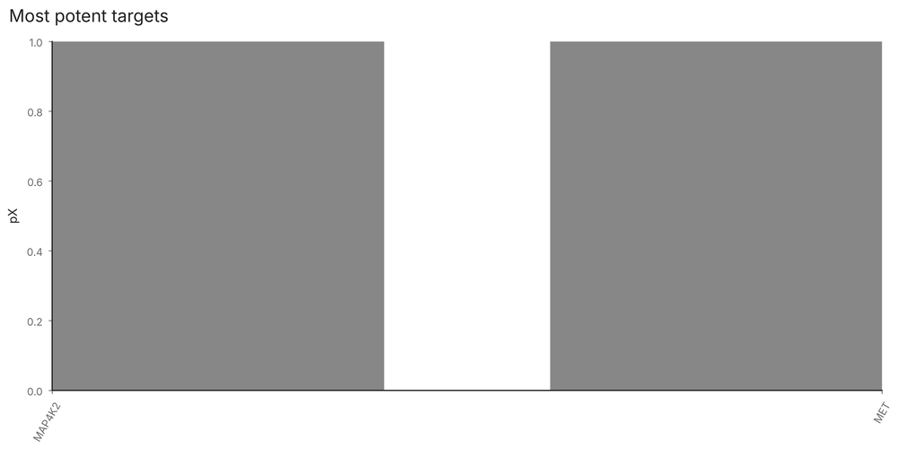 | 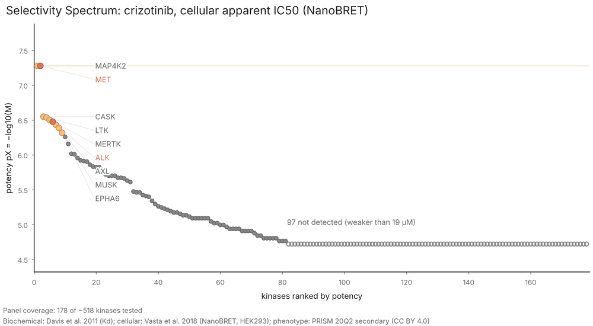 |

**Caption (generated).** crizotinib binds its intended target ALK, MET at 52.6 nM (rank 2 of 178 tested). 7 off-target(s) are highlighted (3.9% of the panel); the strongest is MAP4K2 at 52.6 nM. No exposure (free Cmax) was supplied, so off-targets are highlighted if within 10-fold of the intended target's potency.

**What changes:**
- the whole panel, strongest first, with censored (not detected) targets shown and counted
- off-targets judged against exposure (free Cmax band) when supplied, otherwise by a stated 10-fold rule; panel coverage in the footer

## Window: Is there a dose that works without the toxicity?

PRISM 20Q2 secondary (Corsello et al. 2020, CC BY 4.0): dabrafenib in A375 (BRAF V600E melanoma) against the median of 676 non-skin lines as the toxicity proxy (CS2).

| Classic: overlaid dose-response curves | tincture: Window |
|---|---|
| 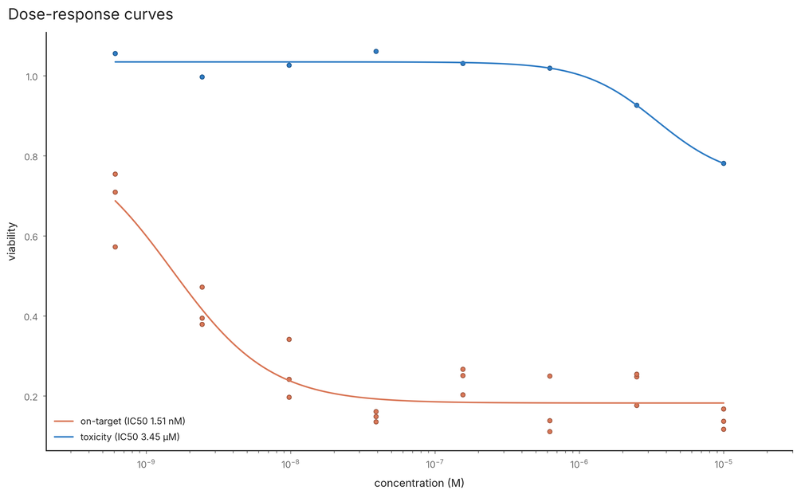 | 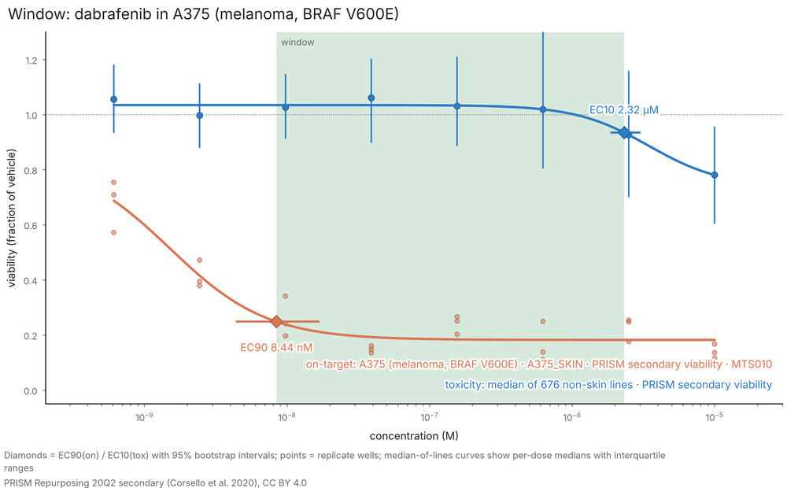 |

**Caption (generated).** Dabrafenib reaches 90% of its effect at 8.44 nM (95% CI 4.38 nM–16.9 nM) before the toxicity readout loses 10% viability (EC10(tox) 2.32 µM): a window of 275-fold. No exposure (free Cmax) was supplied, so the window is not placed against clinical concentrations.

**What changes:**
- EC90 (on-target) and EC10 (toxicity) with bootstrap intervals instead of IC50s
- the window is drawn only when both fits pass quality checks, and is open-ended when toxicity never appears in the tested range
- exposure (free Cmax) is a band, never a line, and only when supplied

## Neighbourhood Card: Which annotated compounds does this one resemble?

LINCS L1000 phase II (GEO GSE70138) consensus signatures, 603 compounds with Repurposing Hub MoA; bortezomib left out of its own library (CS7). Shown with the **unrelated-pairs null**; under the handover's all-pairs null (the current default) the same card reports 'no confident neighbour' (top neighbour oprozomib, q = 0.056). The all-pairs null stays the default (decision recorded in docs/milestone_5.md).

| Classic: ranked similarity bars | tincture: Neighbourhood Card |
|---|---|
| 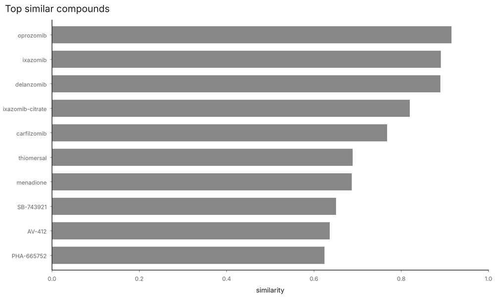 | 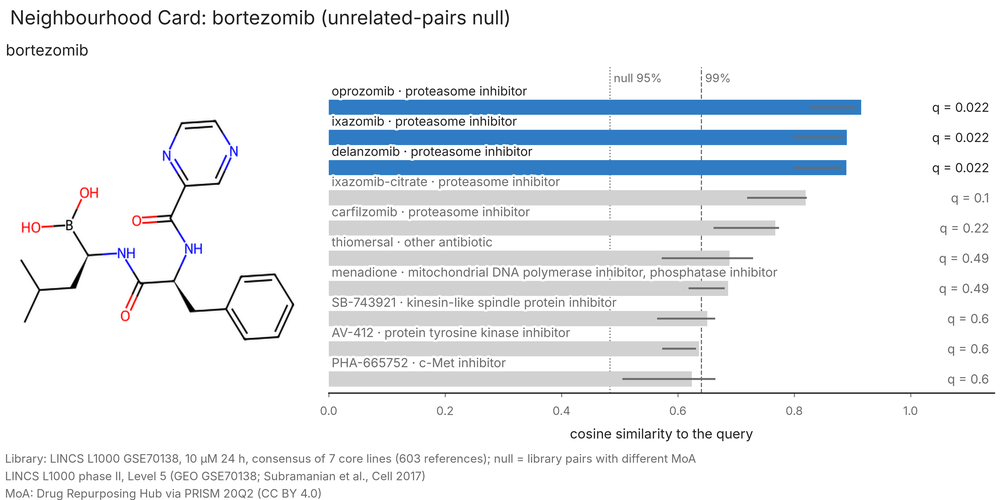 |

**Caption (generated).** bortezomib most resembles oprozomib (proteasome inhibitor; cosine 0.92, q = 0.022). 3 of the top 10 neighbours pass q < 0.05; 3 of them share this MoA. Grey bars do not pass q < 0.05.

**What changes:**
- each neighbour gets a q value against the library's own null, and only confident neighbours are coloured; with none, the card says so
- similarity intervals from the query's own replicate signatures
- the query's structure sits next to its neighbours

## Onset Timeline: What happens first, and what follows?

MIX-seq (McFarland, Paolella et al. 2020, CC BY 4.0): trametinib 0.1 µM vs DMSO in 24 pooled cancer cell lines at 3, 6, 12, 24 and 48 h; PROGENy and Hallmark scores per cell line, tested across lines (CS8).

| Classic: pathway scores over time | tincture: Onset Timeline |
|---|---|
| 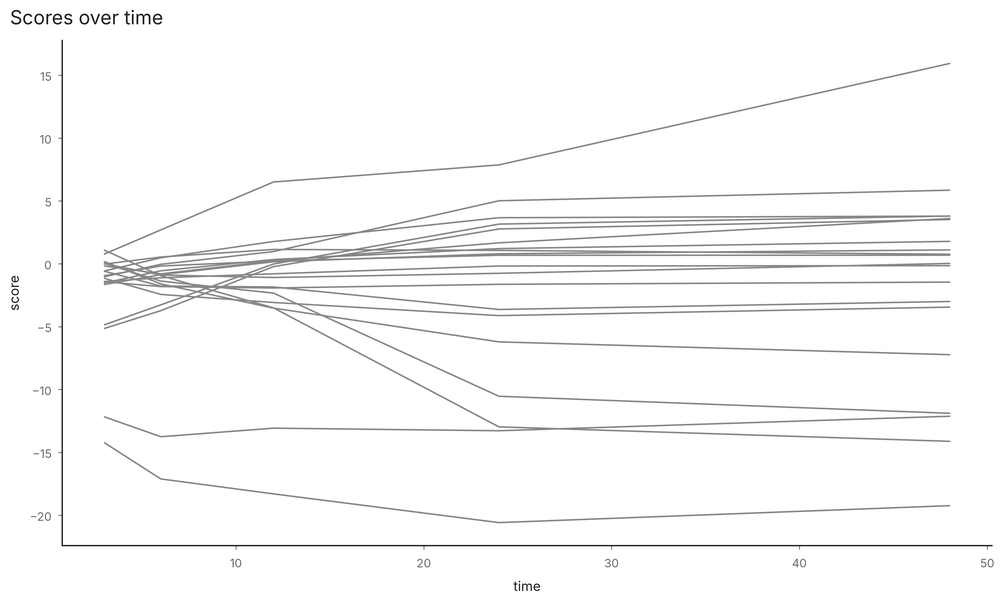 | 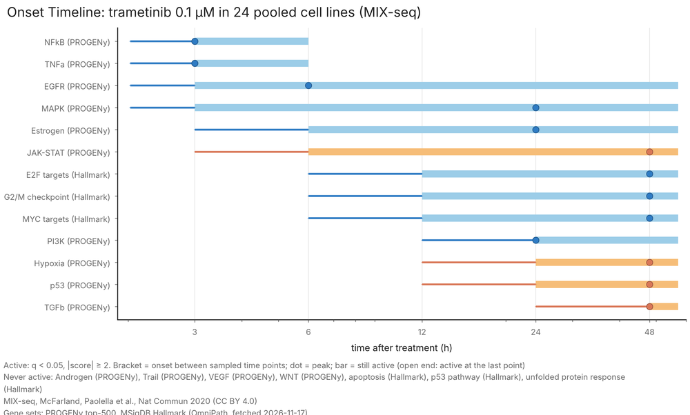 |

**Caption (generated).** First to respond (onset in (0, 3] h): NFkB (PROGENy) (down, peak at 3 h), TNFa (PROGENy) (down, peak at 3 h), EGFR (PROGENy) (down, peak at 6 h), MAPK (PROGENy) (down, peak at 24 h). 9 pathway(s) start strictly later, e.g. Estrogen (PROGENy) (onset in (3, 6] h). 11 remain active at the last time point (48 h). 7 pathway(s) never become active: Androgen (PROGENy), Trail (PROGENy), VEGF (PROGENy), WNT (PROGENy), apoptosis (Hallmark), p53 pathway (Hallmark), unfolded protein response (Hallmark). Onsets are intervals between sampled time points (3, 6, 12, 24, 48 h); the true onset can lie anywhere inside the bracket.

**What changes:**
- onset is an interval between sampled time points, never a precise point
- rows ordered by onset, so the sequence (MAPK output first, cell cycle later, p53 later still) reads top to bottom
- peak and persistence on the same row; pathways that never respond are listed

## Plate Atlas: can we trust this plate?

Shown on **synthetic** test plates: GDSC-derived plate figures are kept local (licence; see `docs/data_status.md`). Run `case_studies/cs3_plate_qc.py` to see it on all 16,354 GDSC2 plates.

| Classic: plate heatmap | tincture: Plate Atlas |
|---|---|
|  | 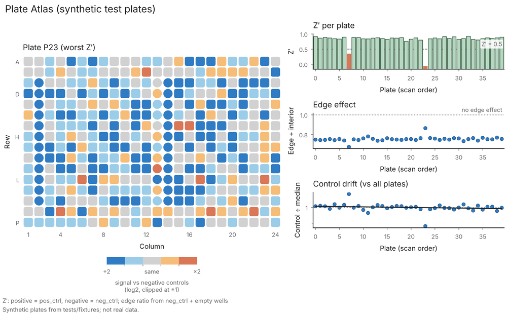 |

**Caption (generated).** 40 plates (384-well); median Z′ 0.86 (IQR 0.84–0.88); 2 (5%) fall below 0.5. Failing plates: P07, P23. The outermost seeded ring reads 75% of interior wells (median over plates; neg_ctrl + empty wells with cells). Negative-control level (relative to all plates) changes -2% across the 40 plates in scan order (Theil–Sen; Spearman ρ = -0.32, p = 0.041).

**What changes:**
- Z′ per plate with the 0.5 line, edge effect and control drift next to the plate map, so a bad plate is visible at a glance
- controls and absent wells are marked; the QC definitions are printed

## Combination Surface: Is there a reachable dose pair where the combination beats expectation?

Shown on **synthetic** data: GDSC combination figures are kept local (licence). Run `case_studies/cs4_gdsc_anchored.py` and `cs5_gdsc_matrix.py` for the real data.

| Classic: synergy heatmap | tincture: Combination Surface |
|---|---|
| 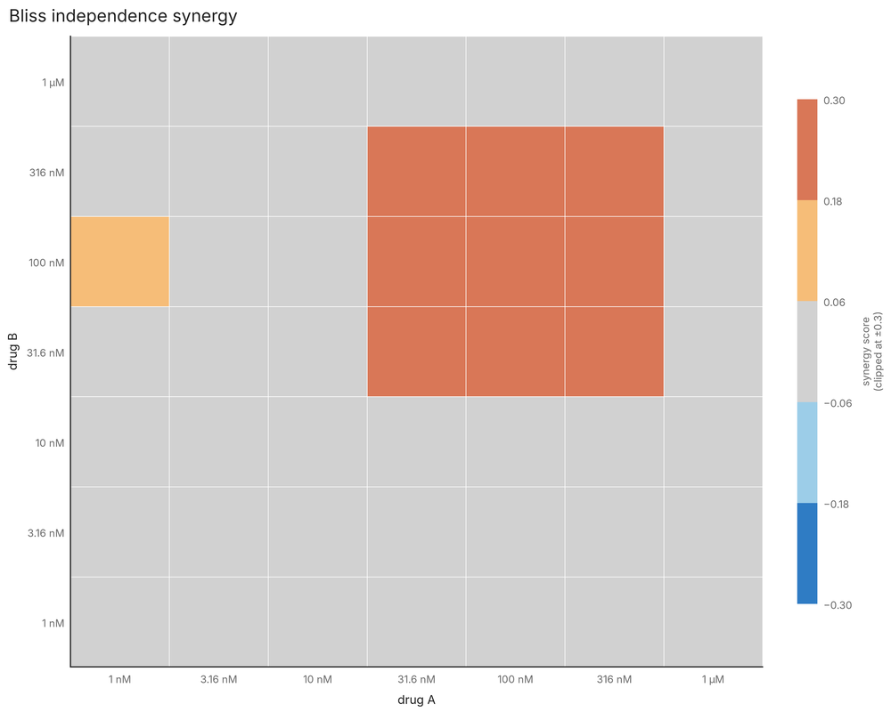 | 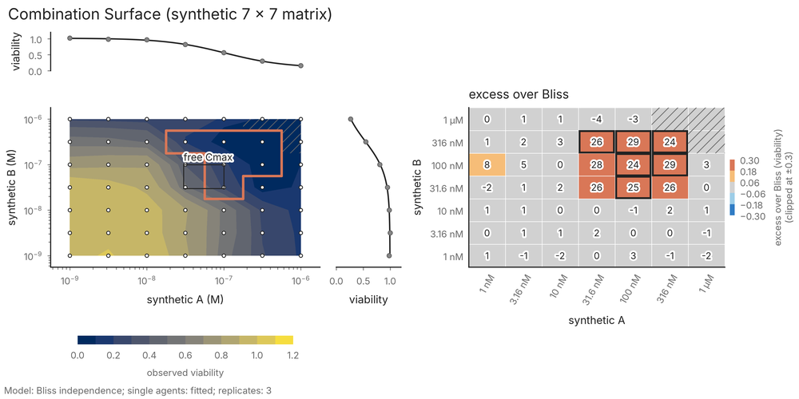 |

**Caption (generated).** synthetic A + synthetic B in synthetic line: observed viability reaches 0% at the highest doses (3 replicate matrices). Under Bliss independence, 6 of 46 testable cells show significant excess ≥ 10% (BH q < 0.05); the largest is +29% at 316 nM synthetic A + 100 nM synthetic B. Benefit over the best single agent (HSA) ≥ 10% is significant in 8 cell(s). 3 cell(s) are hatched: expected inhibition exceeds 90%, so excess there is not interpretable. 2 significant cell(s) lie inside the clinically reachable box (free Cmax). Note: only 3 replicates: intervals are wide.

**What changes:**
- the observed response surface (interpolated only inside the measured grid) next to the excess over the reference model (Bliss by default; ZIP and HSA available)
- only cells with significant excess ≥ 10% are outlined; cells with no room for excess (expected inhibition > 90%) are hatched, not scored
- the clinically reachable box (free Cmax) when supplied, and benefit over the best single agent reported alongside synergy

## Combination Lift: In which cell lines does the combination beat the best single agent?

Shown on **synthetic** data: GDSC combination figures are kept local (licence). Run `case_studies/cs4_gdsc_anchored.py` and `cs5_gdsc_matrix.py` for the real data.

| Classic: waterfall of ΔEmax | tincture: Combination Lift |
|---|---|
| 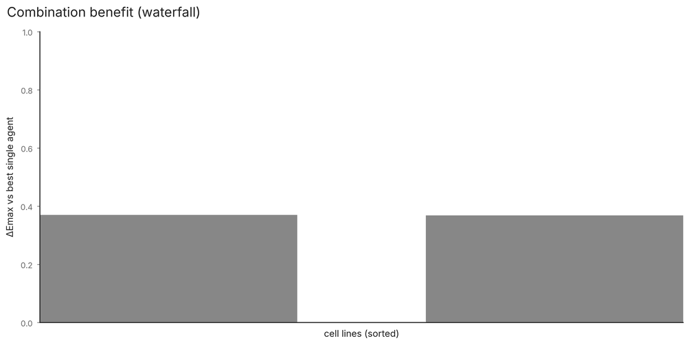 | 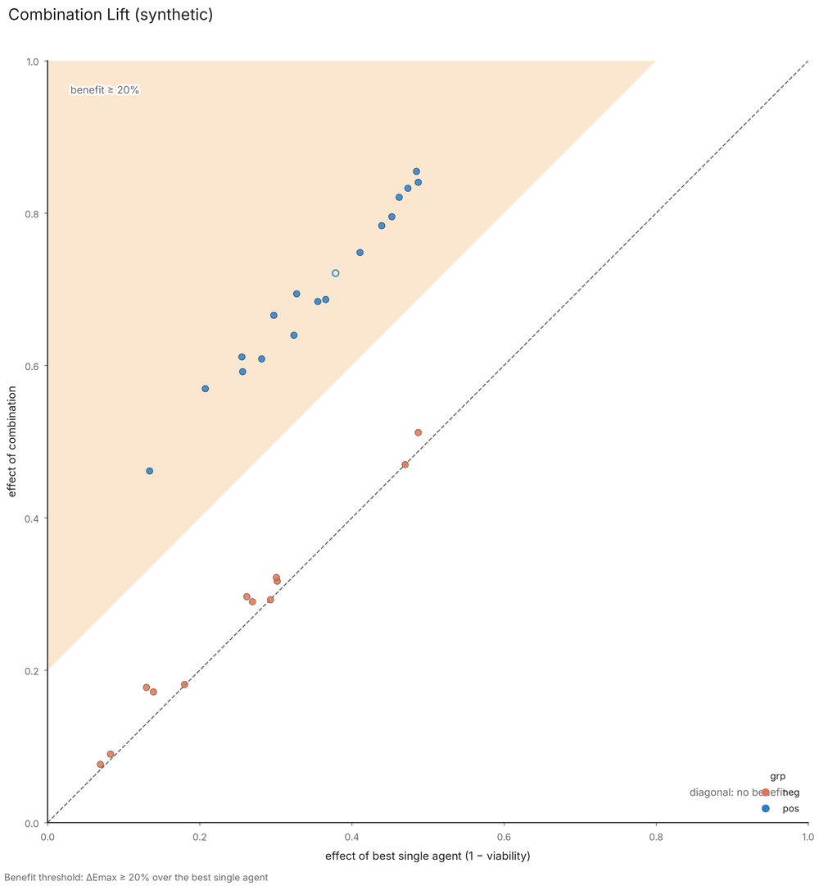 |

**Caption (generated).** drug A + drug B: 17 of 29 cell lines (59%) show benefit (combination effect ≥ 20% above the best single agent); by grp: neg 0/12 (0%), pos 17/17 (100%) (Fisher p < 0.001; ΔEmax Mann–Whitney p < 0.001). 1 cell line(s) with failed fits are hollow and not counted.

**What changes:**
- every cell line against the no-benefit diagonal, with the benefit threshold as a band
- groups (tissue, biomarker) compared with a stated test; failed fits hollow and not counted
