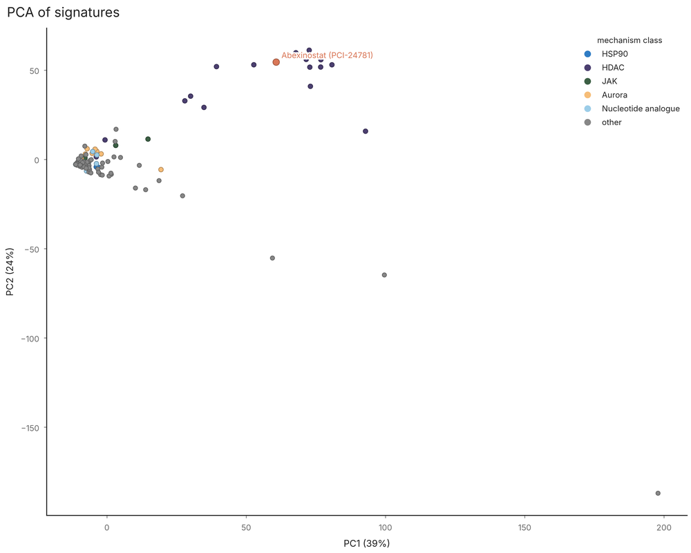
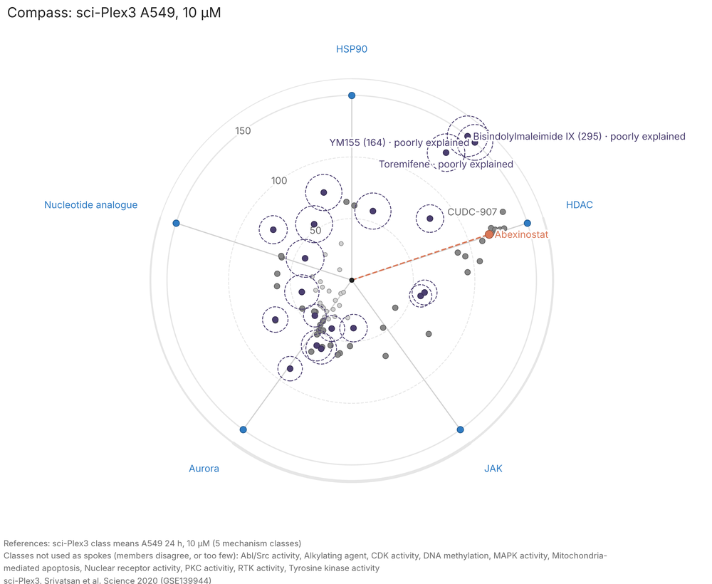
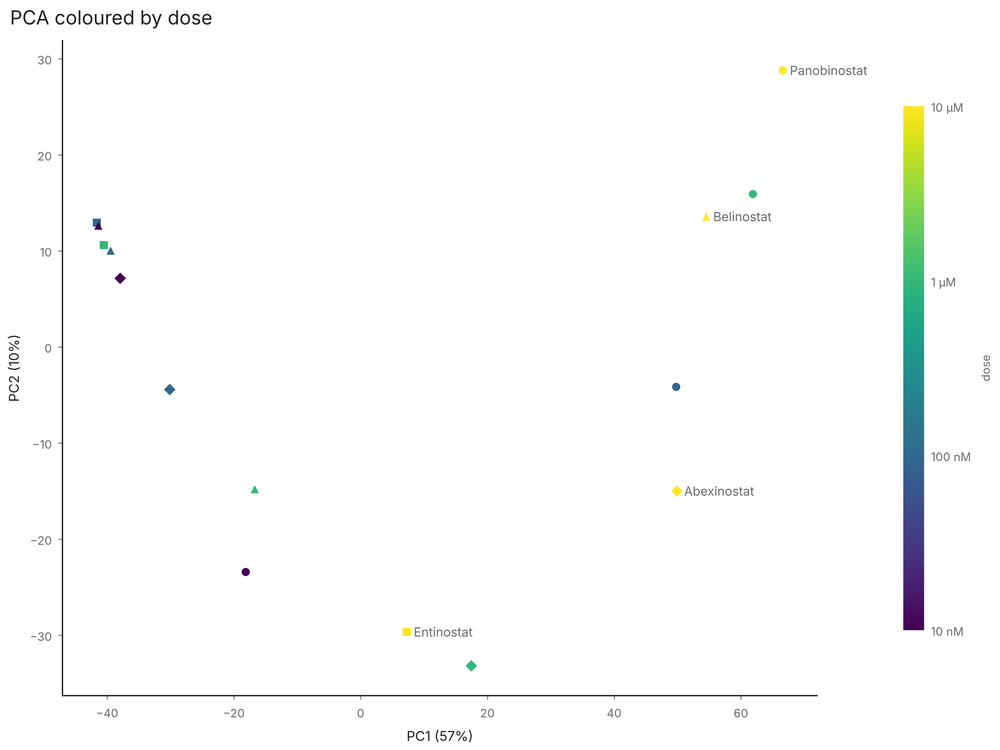
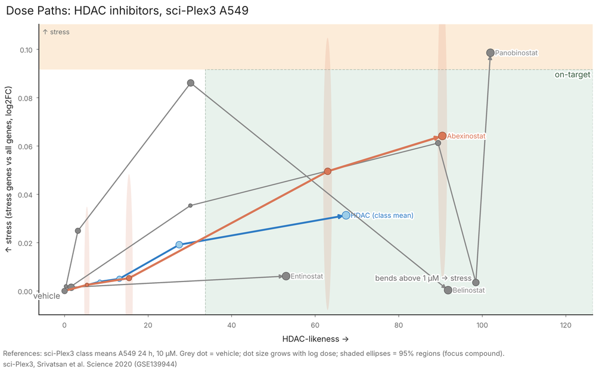
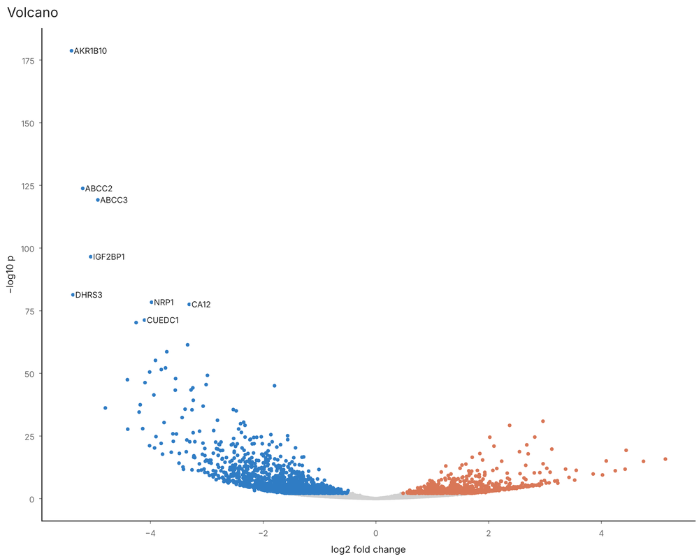
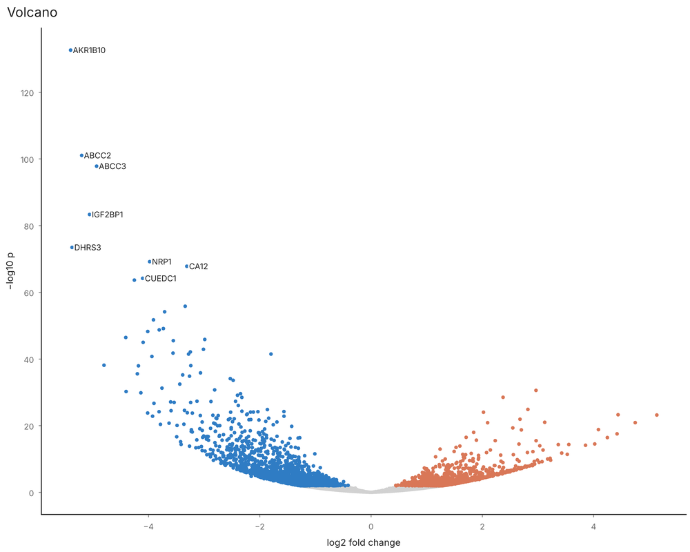
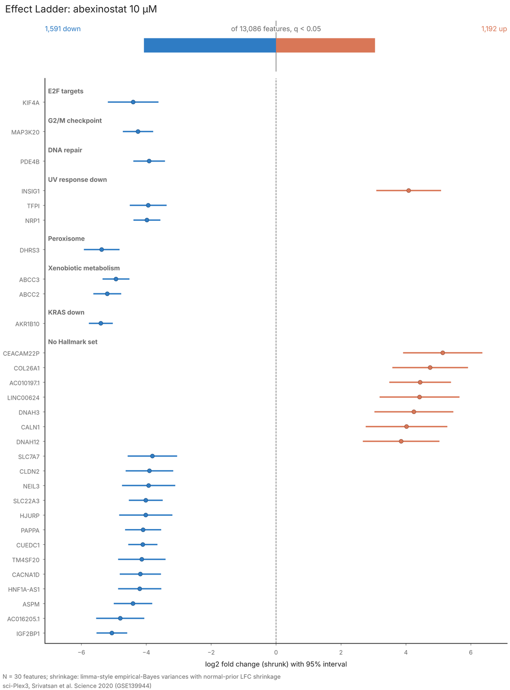
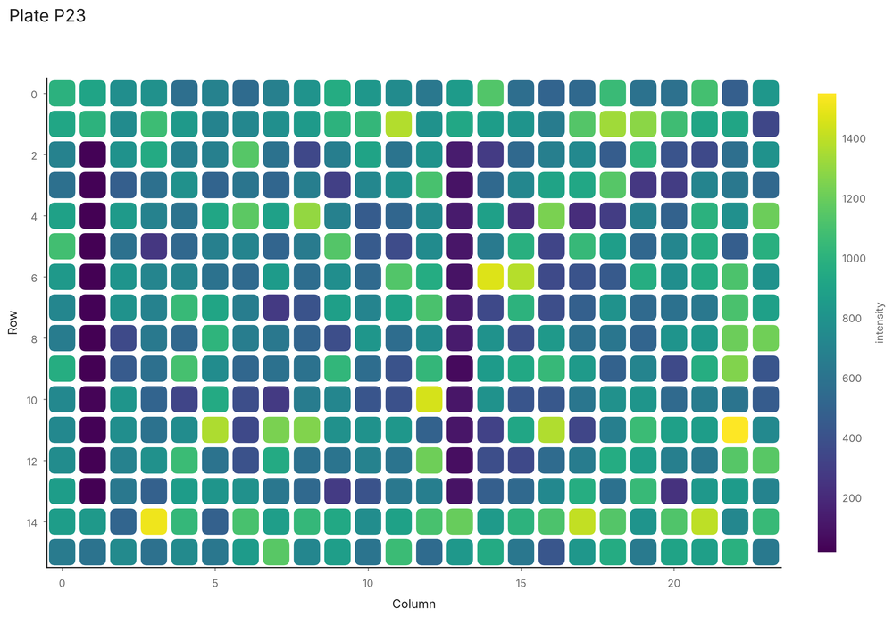

# Gallery

Each plot answers one drug-discovery question. The left column is the plot people usually draw (tincture exports it too, as the *classic fallback*); the right column is the question-first version. Real data: sci-Plex3 A549, 24 h (Srivatsan et al. 2020, GEO GSE139944); abexinostat, an HDAC inhibitor, is the focus compound (terracotta). Reproduce with `python case_studies/cs1_sciplex_hdac.py` then `python docs/make_gallery.py`.

## Retrievability: Is the effect real?

| Classic: replicate scatter | tincture: Retrievability |
|---|---|
|  |  |

**Caption (generated).** 274 of 752 conditions (36%) have a reproducible phenotype (mAP, q < 0.05; replicates ranked against vehicle profiles); median mAP 0.42. Abexinostat (PCI-24781) 10 µM: mAP 1.00, q = 0.039 (retrievable). Replicate top-feature overlap for Abexinostat (PCI-24781) 10 µM exceeds the random band at 100% of k values. Note: the q-value boundary is not a single mAP value here (null depends on replicate counts); colours show per-condition calls.

**What changes:**
- every condition is tested against vehicle, with an FDR-controlled call per condition, instead of one correlation driven by a few large genes
- the null band shows what 'no phenotype' looks like; non-retrievable conditions are greyed and later plots can drop them (the gate)

## Compass: What known mechanism does this compound resemble, and how strongly?

| Classic: PCA (reference classes coloured) | tincture: Compass |
|---|---|
|  |  |

**Caption (generated).** Abexinostat most resembles HDAC (weight 0.98); 3% of its signature is unexplained by the 5 references. Its position is precise: the 95% region is smaller than the marker. 102 compounds; distance from centre = noise-corrected signature magnitude (log-fold changes vs vehicle). 19 with enough signal are poorly explained by the references (residual > 0.5, purple); 43 are too weak to judge (light grey). 2 compound(s) beyond the outer ring (150) are drawn on it, with their magnitude in brackets. Note: 86 compound(s) failed the retrievability gate and are not shown.

**What changes:**
- axes are mechanisms (reference classes), not principal components
- distance = noise-corrected signal strength; the residual says how much is unexplained, and compounds the references cannot explain are flagged
- the reference set and its version are printed; members are fitted leave-one-out

## Dose Paths: Does the mechanism change with dose?

| Classic: PCA coloured by dose | tincture: Dose Paths |
|---|---|
|  |  |

**Caption (generated).** Abexinostat moves from vehicle towards HDAC across 10 nM–10 µM without a significant bend (smallest corrected p = 0.84). 1 of 3 other compounds bend significantly: Panobinostat.

**What changes:**
- each compound is a path from vehicle through its doses, on axes with meaning (likeness to the reference; stress)
- bends are tested (turn > 30° beyond noise) and only significant ones are annotated; the reference class's own path is drawn for comparison

## Fingerprint Strip: What did each compound do, at pathway level?

| Classic: volcano (one compound) | tincture: Fingerprint Strip |
|---|---|
|  |  |

**Caption (generated).** 48 compounds × 48 pathways. Abexinostat is most similar to M344 (r = 0.99); strongest effect: E2F targets (down). Rows: references first in the given order, then average-linkage clustering of score correlations (optimal leaf order). 2 pathway(s) with no significant cell are not shown.

**What changes:**
- many compounds × curated pathway groups at once, references first
- non-significant cells are neutral (BH over the whole matrix); colour limits and row ordering are stated

## Effect Ladder: Which genes moved, and how sure are we?

| Classic: volcano | tincture: Effect Ladder |
|---|---|
|  |  |

**Caption (generated).** Top 30 features of Abexinostat at 10 µM by |shrunk log2 fold change|; 30 have 95% intervals excluding zero. Across all 13,086 features, 1,192 go up and 1,591 go down (q < 0.05).

**What changes:**
- the top genes with 95% intervals, grouped by gene set; intervals crossing zero are grey
- the count strip keeps the volcano's overview: how many genes went up and down across the transcriptome

## Plate Atlas: can we trust this plate?

Shown on **synthetic** test plates: GDSC-derived plate figures are kept local (licence; see `docs/data_status.md`). Run `case_studies/cs3_plate_qc.py` to see it on all 16,354 GDSC2 plates.

| Classic: plate heatmap | tincture: Plate Atlas |
|---|---|
|  |  |

**Caption (generated).** 40 plates (384-well); median Z′ 0.86 (IQR 0.84–0.88); 2 (5%) fall below 0.5. Failing plates: P07, P23. The outermost seeded ring reads 75% of interior wells (median over plates; neg_ctrl + empty wells with cells). Negative-control level (relative to all plates) changes -2% across the 40 plates in scan order (Theil–Sen; Spearman ρ = -0.32, p = 0.041).

**What changes:**
- Z′ per plate with the 0.5 line, edge effect and control drift next to the plate map, so a bad plate is visible at a glance
- controls and absent wells are marked; the QC definitions are printed
